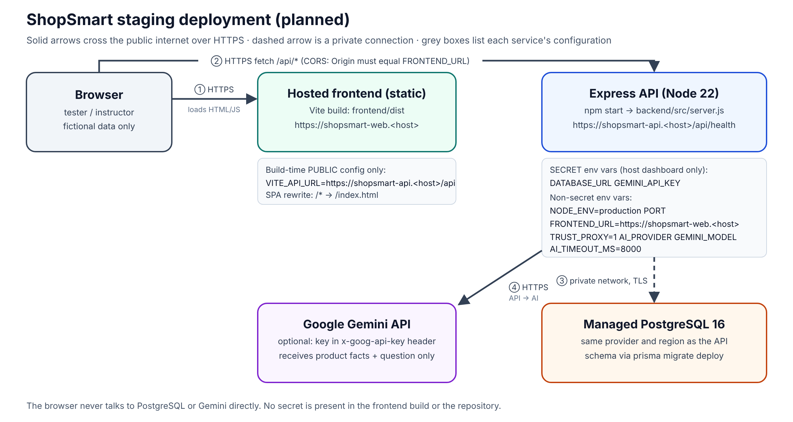

# ShopSmart Deployment Plan (private staging)

Status: **plan only.** No hosting or database has been approved for the class, so no live staging was done. The release is a **local release candidate** (see `RELEASE_NOTE.md`).

(Editable copy: `deployment-diagram.svg`.)

## Service paths

| # | Connection | Crosses the internet? | Protection |
|---|---|---|---|
| ① | Browser → hosted frontend (HTML, JS, CSS) | Yes | HTTPS from the host |
| ② | Browser → Express API `/api/*` | Yes | HTTPS. CORS allows only the origin in `FRONTEND_URL` (`NODE_ENV=production` turns off the localhost allowance; verified in test T12) |
| ③ | Express API → PostgreSQL | No: the host's private or internal network. If the platform only offers an external URL, use TLS (`sslmode=require`) | `DATABASE_URL` held as a server secret |
| ④ | Express API → Gemini (optional) | Yes | HTTPS. Key sent in the `x-goog-api-key` header from the server only. Only product facts and the redacted question are sent |

## Configuration per service

| Service | Variable | Value (staging) | Kind | Where it is stored |
|---|---|---|---|---|
| Frontend | `VITE_API_URL` | `https://shopsmart-api.<host>/api` | **Public**: Vite copies every `VITE_` variable into the browser bundle | Host's build environment. Never a secret |
| Frontend | `DEV_PORT` | not used in staging | Local only | `frontend/.env` |
| API | `NODE_ENV` | `production` | Config | Host env |
| API | `PORT` | Set by the host (the server reads `process.env.PORT`) | Config | Host env |
| API | `FRONTEND_URL` | `https://shopsmart-web.<host>`: exact origin, no trailing slash, no path | Config | Host env |
| API | `TRUST_PROXY` | `1` | Config | Host env |
| API | `DATABASE_URL` | Internal connection string from the managed database | **Secret** | Host env/secret store only |
| API | `GEMINI_API_KEY` | Team's key, only if live AI is approved; leave empty for catalog-only answers | **Secret** | Host env/secret store only |
| API | `AI_PROVIDER`, `GEMINI_MODEL`, `AI_TIMEOUT_MS` | `gemini`, `gemini-3.8-flash`, `8000` (or `AI_PROVIDER=off`) | Config | Host env |
| Database | Admin password | Generated by the provider | **Secret** | Provider dashboard; only the API's `DATABASE_URL` uses it |

## Answers to the challenge questions

**1. Where will the Vite build files be hosted, and which URL will the frontend use for the API?**
A static-site service on the approved host. It serves `frontend/dist`, built with `npm ci && npm run build`. It needs a rewrite from `/*` to `/index.html` so that refreshing `/cart` or `/products/2` does not return 404. The build sets `VITE_API_URL=https://shopsmart-api.<host>/api`, so every fetch goes to the hosted API and never to `localhost`.

**2. Where will the Express server run, and what public URL will serve `/api/health`?**
A Node 22 web service on the same host. Settings: root `ShopSmart-Starter`, build command `npm ci --include=dev && npm run db:generate` (the Prisma CLI is a dev dependency, and some hosts skip dev dependencies when `NODE_ENV=production`), start command `npm start` (runs `node backend/src/server.js`). Health URL: `https://shopsmart-api.<host>/api/health`. Use it as the platform health check path. It now returns 200 `{"status":"ok","database":"ok"}` only when PostgreSQL answers, and 503 otherwise (defect D3).

**3. Where will PostgreSQL run, and how will the server receive `DATABASE_URL` securely?**
A managed PostgreSQL 16 instance from the same provider and region as the API. The provider's internal connection string is pasted into the API service's environment settings. It never goes into the repository, `frontend/.env`, screenshots or chat. Local `backend/.env` stays git-ignored.

**4. Which origin will be permitted by `FRONTEND_URL` and the API CORS configuration?**
Exactly one: `https://shopsmart-web.<host>`. `FRONTEND_URL` accepts a comma-separated list if a second origin is ever needed. With `NODE_ENV=production`, `http://localhost:*` is refused (verified: no `Access-Control-Allow-Origin` header for `http://localhost:5173`).

**5. Where will a provider key be stored, and how is it kept out of the bundle and repository?**
Only in the API service's secret environment, as `GEMINI_API_KEY`. It has no `VITE_` prefix, so Vite never reads it. Only backend code (`services/aiProvider.js`) uses it, and it sends the key in a request header, never in a URL or a log. `/api/assistant/status` reports only `keyConfigured: true/false`. Before release, run a bundle scan like test T12 (`grep -r "AIza\|DATABASE_URL" frontend/dist` must find nothing), and `.gitignore` excludes `.env` and `.env.*`.

**6. How will migrations be applied before first use, without wiping existing orders?**
- Migrations are now committed in `backend/prisma/migrations/` (defect D2 fixed).
- Before each release, run `npm run db:deploy` (= `prisma migrate deploy`) against the staging database, from the host's pre-deploy step or once from a trusted machine with the staging `DATABASE_URL` in the shell environment. `migrate deploy` only applies pending committed migrations. It never resets data and never creates new migrations.
- **Never** run `npm run db:migrate` (`migrate dev`) against staging. It is for local development and may offer to reset the database.
- **Never** run `npm run db:seed` against a database with orders you need. To load the 6 sample products once, run the seed only on the fresh, empty staging database. The seed now refuses to run when `NODE_ENV=production` and any order exists.
- If a database already has the tables but no migration history (an older local copy), baseline it instead of resetting: `npx --workspace backend prisma migrate resolve --applied 20261116063853_initial_schema`. This was tested on a scratch database: the existing rows were kept.
- Back up first: take a provider snapshot (or `pg_dump`) before applying a new migration to a database with work in it.

**7. Who can access the staging app, and will only fictional customer data be used?**
Only me (the student) and the instructor. Keep the URLs unlisted, and use the platform's access protection or IP allow-list where available. Share access instructions privately with the instructor, not in the repository. ShopSmart has no authentication (limitation L2), so staging must never be announced publicly. Checkout must only receive fictional names, emails (`@example.com`) and addresses. The site footer already states "Simulated purchases only". Delete the staging services after grading.

## Release procedure (when hosting is approved)

1. Create the PostgreSQL instance. Copy its internal URL into the API service as `DATABASE_URL`.
2. Create the API service with the variables above. Run `npm run db:deploy`, then, only on the empty database, the seed once.
3. Open `https://shopsmart-api.<host>/api/health`. Expect `{"status":"ok","database":"ok"}`.
4. Create the static site with `VITE_API_URL` and the SPA rewrite. Set the API's `FRONTEND_URL` to the static site's exact origin and redeploy the API.
5. Smoke test with fictional data: products, search, cart, checkout, assistant. Record the date, URLs and results in `RELEASE_NOTE.md`. Confirm the order count increased and nothing was reseeded.
6. Scan the deployed JS bundle for secrets and check the browser console for CORS errors.

Platform-specific clicks and commands must be checked against the approved platform's current documentation. References: Prisma 6 `migrate deploy` (docs.prisma.io/docs/orm/v6/prisma-migrate/workflows/development-and-production) and Vite environment variables (vite.dev/guide/env-and-mode).
